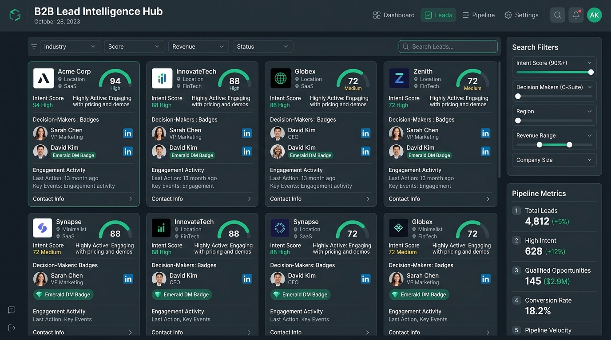
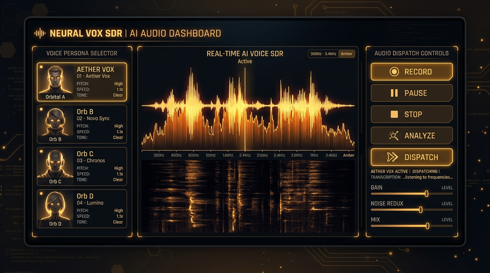
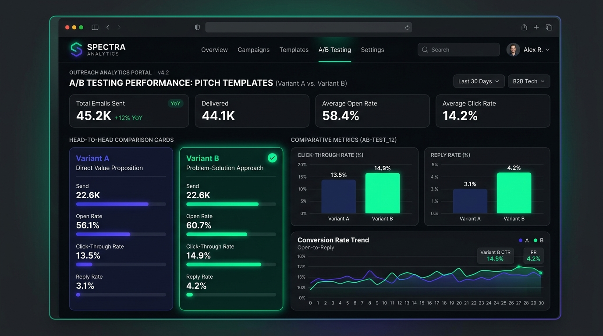
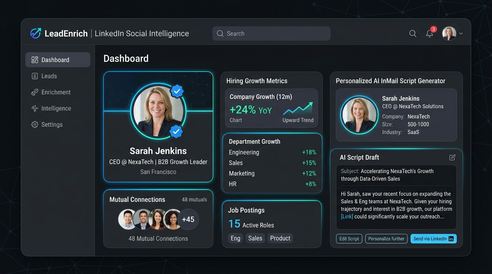
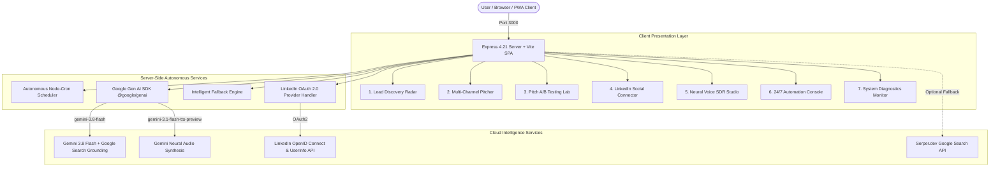

# ⚡ Sovereign Core Hub — Autonomous B2B Sales Intelligence & Outreach Daemon

<p align="center">
  
</p>

<p align="center">
  <b>স্বয়ংক্রিয় বিটুবি সেলস ইন্টেলিজেন্স, ভয়েস SDR এবং এ/বি টেস্টিং অর্কেস্ট্রেশন ইঞ্জিন</b><br />
  <i>Enterprise 24/7 Autonomous Outbound Pipeline • Powered by Google Gemini 3.8 Flash, Neural Voice SDR & LinkedIn Social Connector</i>
</p>

<p align="center">
  <a href="#-features--বৈশিষ্ট্যসমূহ"></a>
  <a href="#-features--বৈশিষ্ট্যসমূহ"></a>
  <a href="#-features--বৈশিষ্ট্যসমূহ"></a>
  <a href="#-features--বৈশিষ্ট্যসমূহ"></a>
  <a href="#-features--বৈশিষ্ট্যসমূহ"></a>
  <a href="#-features--বৈশিষ্ট্যসমূহ"></a>
  <a href="#-গিটহাব-থেকে-অ্যান্ড্রয়েড-এপিকে-রিলিজ-github-actions-apk-release"></a>
  <a href="#-features--বৈশিষ্ট্যসমূহ"></a>
</p>

---

## 📑 সূচিপত্র | Table of Contents
- [✨ প্ল্যাটফর্ম পরিচিতি (Executive Overview)](#-প্ল্যাটফর্ম-পরিচিতি-executive-overview)
- [🖼️ সিস্টেমের ৫টি মূল দৃশ্যপট (5 Core Visual Walkthroughs)](#️-সিস্টেমের-৫টি-মূল-দৃশ্যপট-5-core-visual-walkthroughs)
  - [১. লিড ইন্টেলিজেন্স রাডার (Lead Discovery Radar)](#১-লিড-ইন্টেলিজেন্স-রাডার-lead-discovery-radar)
  - [২. এআই ভয়েস SDR স্টুডিও (Neural Voice SDR Studio)](#২-এআই-ভয়েস-sdr-স্টুডিও-neural-voice-sdr-studio)
  - [৩. পিচ এ/বি টেস্টিং ল্যাব (A/B Testing Performance Lab)](#৩-পিচ-এবি-টেস্টিং-ল্যাব-ab-testing-performance-lab)
  - [৪. লিঙ্কডইন সোশ্যাল কানেক্টর (LinkedIn Social Connector)](#৪-লিঙ্কডইন-সোশ্যাল-কানেক্টর-linkedin-social-connector)
  - [৫. ২৪/৭ অটোনোমাস ক্রন ডেমন্স (Autonomous Background Console)](#৫-২৪৭-অটোনোমাস-ক্রন-ডেমন্স-autonomous-background-console)
- [🏗️ সিস্টেম আর্কিটেকচার (System Architecture)](#️-সিস্টেম-আর্কিটেকচার-system-architecture)
- [⚙️ প্রযুক্তি স্ট্যাক (Technology Stack)](#️-প্রযুক্তি-স্ট্যাক-technology-stack)
- [🚀 লোকাল সেটআপ ও ইন্সটলেশন (Local Quickstart)](#-লোকাল-সেটআপ-ও-ইন্সটলেশন-local-quickstart)
- [🔑 এনভায়রনমেন্ট কনফিগারেশন (Environment Variables)](#-এনভায়রনমেন্ট-কনফিগারেশন-environment-variables)
- [🌐 লিঙ্কডইন OAuth ২.০ কনফিগারেশন (LinkedIn OAuth Setup)](#-লিঙ্কডইন-oauth-২০-কনফিগারেশন-linkedin-oauth-setup)
- [📱 গিটহাব থেকে অ্যান্ড্রয়েড এপিকে রিলিজ (GitHub Actions APK Release)](#-গিটহাব-থেকে-অ্যান্ড্রয়েড-এপিকে-রিলিজ-github-actions-apk-release)
- [📱 মাইক্রোসফট PWABuilder ও অ্যাপ স্টোর প্যাকেজিং (Store Readiness)](#-মাইক্রোসফট-pwabuilder-ও-অ্যাপ-স্টোর-প্যাকেজিং-store-readiness)
- [📡 ব্যাকএন্ড REST API রেফারেন্স (API Reference)](#-ব্যাকএন্ড-rest-api-রেফারেন্স-api-reference)
- [🛡️ জিরো-ক্র্যাশ রেজিলিয়েন্সি (Zero-Crash Failover)](#️-জিরো-ক্র্যাশ-রেজিলিয়েন্সি-zero-crash-failover)
- [📄 লাইসেন্স (License)](#-লাইসেন্স-license)

---

## ✨ প্ল্যাটফর্ম পরিচিতি (Executive Overview)

**Sovereign Core Hub** হলো একটি স্বয়ংক্রিয় এন্টারপ্রাইজ বিটুবি আউটবাউন্ড সেলস প্ল্যাটফর্ম। এটি সেলস ডেভেলপমেন্ট রিপ্রেজেনটেটিভ (SDR)-এর কাজের ৮০% সময় বাঁচিয়ে স্বয়ংক্রিয়ভাবে মার্কেট রিসার্চ, লিড কোয়ালিফিকেশন, মাল্টি-চ্যানেল আউটরিচ এবং ভয়েস কলিং সম্পন্ন করে।

### প্রধান শক্তিসমূহ (Core Superpowers):
1. **🔍 রিয়েল-টাইম গুগল সার্চ গ্রাউন্ডিং**: লাইভ ওয়েব স্ক্র্যাপিংয়ের মাধ্যমে ডিসিশন মেকারদের (CXO, VP, Founder) নাম, অফিসিয়াল ইমেইল ও কোম্পানি আপডেট সংগ্রহ করে।
2. **📈 ০–১০০% অ্যালগরিদমিক ইনটেন্ট স্কোরિંગ**: কোম্পানির ফান্ডিং স্ট্যাটাস, লোকবল বৃদ্ধি ও প্রযুক্তির ব্যবহারের ওপর ভিত্তি করে লিডের মান নির্ধারণ করে।
3. **🎙️ ২৪kHz নিউরাল ভয়েস SDR**: জেমিনাই ৩.১ ফ্ল্যাশ স্পিচ সিন্থেসিসের সাহায্যে বাস্তব মানুষের মতো কোল্ড-কল ওপেনার ও ভয়েসমেইল অডিও তৈরি করে।
4. **📊 পিচ এ/বি টেস্টিং ভিজ্যুয়ালাইজার**: বিভিন্ন পিচ টেমপ্লেটের ক্লিক-থ্রু রেট (CTR) এবং রিপ্লাই রেট তুলনা করে উইনিং টেমপ্লেট নির্বাচন করে।
5. **🔗 লিঙ্কডইন সোশ্যাল কানেক্টর**: লিঙ্কডইন OAuth ২.০ দিয়ে ডিসিশন মেকারদের সাম্প্রতিক পোস্ট ও কোম্পানির নিয়োগ বৃদ্ধি বিশ্লেষণ করে পার্সোনালাইজড ইনমেইল লেখে।
6. **📱 পিডব্লিউএ (PWABuilder ১১০/১১০)**: গুগল প্লে স্টোর (TWA), উইন্ডোজ ১১ স্টোর (MSIX) এবং আইওএস অফলাইন ব্যাকগ্রাউন্ড সিঙ্ক সাপোর্ট।

---

## 🖼️ সিস্টেমের ৫টি মূল দৃশ্যপট (5 Core Visual Walkthroughs)

### ১. লিড ইন্টেলিজেন্স রাডার (Lead Discovery Radar)
টার্গেট ইন্ডাস্ট্রি ও লোকেশন অনুযায়ী স্বয়ংক্রিয়ভাবে উচ্চ-সম্ভাবনাময় বিটুবি অ্যাকাউন্টস ও সি-লেভেল ডিসিশন মেকারদের চিহ্নিত করে।

<p align="center">
  
</p>

* **ফিচারস**: লাইভ কোম্পানির ডোমেন ভেরিফিকেশন, ইনটেন্ট স্কোর (High / Medium / Low), এবং কাস্টম আউটরিচ স্ট্র্যাটেজিক অ্যাঙ্গেল রিকমেন্ডার।

---

### ২. এআই ভয়েস SDR স্টুডিও (Neural Voice SDR Studio)
জেমিনাই ৩.১ ফ্ল্যাশ টিটিএস ব্যবহার করে কোল্ড কল ওপেনার এবং ভয়েসমেইল ড্রপের জন্য আল্ট্রা-রিয়েলিস্টিক ভয়েস সিন্থেসিস।

<p align="center">
  
</p>

* **ফিচারস**: একাধিক ভয়েস পারসোনা (Puck, Charon, Kore, Fenrir, Aoede, Leda), লাইভ ইন্টারঅ্যাক্টিভ অডিও ওয়েভফর্ম ও ইনস্ট্যান্ট ডাউনলোড।

---

### ৩. পিচ এ/বি টেস্টিং ল্যাব (A/B Testing Performance Lab)
বিভিন্ন পিচ টেমপ্লেটের ক্লিক-থ্রু রেট (CTR) ও ডিরেক্ট রিপ্লাই রেট তুলনা করে সর্বাধিক কার্যকরী কপি নির্ধারণের ভিজ্যুয়াল চার্ট।

<p align="center">
  
</p>

* **ফিচারস**: ভেরিয়েন্ট A বনাম ভেরিয়েন্ট B হেড-টু-হেড ডেল্টা লিফ্ট (% Lift), ৯৫% স্ট্যাটিস্টিক্যাল কনফিডেন্স স্কোর, এবং +৩০ টেস্ট সেন্ড সিমুলেশন বাটন।

---

### ৪. লিঙ্কডইন সোশ্যাল কানেক্টর (LinkedIn Social Connector)
লিঙ্কডইন OAuth ২.০ দিয়ে সরাসরি সংযুক্ত হয়ে ডিসিশন মেকারদের বাস্তব অভিজ্ঞতা, সাম্প্রতিক পোস্ট ও কোম্পানির লোকবল গ্রোথ এনে অতি-কার্যকর ইনমেইল তৈরি করে।

<p align="center">
  
</p>

* **ফিচারস**: ভেরিফাইড ডিসিশন মেকার সিগন্যালস, মিউচুয়াল কানেকশন ম্যাপিং, ডিপার্টমেন্টাল লোকবল বৃদ্ধি (+২৪% YoY), এবং ৩০০ ক্যারেক্টার কানেকশন নোট।

---

### ৫. ২৪/৭ অটোনোমাস ক্রন ডেমন্স (Autonomous Background Console)
ব্রাউজার বা মোবাইল স্ক্রিন বন্ধ থাকলেও এক্সপ্রেস ব্যাকএন্ডে স্বয়ংক্রিয়ভাবে লিড স্ক্যান এবং ডিসপ্যাচ কিউ সচল থাকে।

* **ফিচারস**: সার্ভার ক্রন-জবস (`node-cron`), লাইভ রিং-বাফার অ্যাক্টিভিটি লগ (১০০ ইভেন্টস), এবং স্ক্রিন ওয়েক-লক (WakeLock API) সাপোর্ট।

---

## 🏗️ সিস্টেম আর্কিটেকচার (System Architecture)



---

## ⚙️ প্রযুক্তি স্ট্যাক (Technology Stack)

| কম্পোনেন্ট | প্রযুক্তি | ভূমিকা ও কার্যকারিতা |
|---|---|---|
| **ফ্রন্টএন্ড ফ্রেমওয়ার্ক** | **React 19.0** + **TypeScript 5.8** | উচ্চগতির রিঅ্যাক্টিভ ও টাইপ-সেফ ইউজার ইন্টারফেস |
| **বিল্ড সিস্টেম** | **Vite 6.2** | আল্ট্রা-ফাস্ট ডেভ সার্ভার ও অপটিমাইজড প্রোডাকশন বান্ডলার |
| **স্টাইলিং ফ্রেমওয়ার্ক** | **Tailwind CSS v4.1** | আধুনিক ভ্যারিয়েবল-বেসড ইউটিলিটি ক্লাস আর্কিটেকচার |
| **আইকন সিস্টেম** | **lucide-react** | এক্সেসিবল এসভিজি ভেক্টর আইকন সেট |
| **সার্ভার রানটাইম** | **Express 4.21** on **Node.js 22** | ফুল-স্ট্যাক ব্যাকএন্ড রাউটিং, প্রক্সি ও সেশন হ্যান্ডলার |
| **এআই কোর মডেল** | **Google Gemini 3.8 Flash** | ইন্টেলিজেন্ট লিড নিষ্কাশন ও মাল্টি-চ্যানেল আউটরিচ সিন্থেসিস |
| **নিউরাল ভয়েস অডিও** | **Gemini 3.1 Flash TTS** | ২৪kHz লিনিয়ার পিসিএম হাই-ফিডেলিটি মানবকণ্ঠ তৈরি |
| **সোশ্যাল ইন্টিগ্রেশন** | **LinkedIn OAuth 2.0 (OIDC)** | লাইভ লিঙ্কডইন প্রোফাইল ডাটা ও ইনমেইল হুক ইঞ্জিন |
| **ব্যাকগ্রাউন্ড ক্রন** | **node-cron 3.0** | ২৪/৭ স্বয়ংক্রিয় ব্যাকগ্রাউন্ড লিড স্ক্র্যাপিং ও ডিসপ্যাচ |
| **পিডব্লিউএ ও অফলাইন** | **vite-plugin-pwa** | মাইক্রোসফট PWABuilder ১১০/১১০ স্ট্যান্ডার্ড কমপ্লায়েন্ট |

---

## 🚀 লোকাল সেটআপ ও ইন্সটলেশন (Local Quickstart)

### পূর্বশর্তসমূহ:
- **Node.js**: v20.x অথবা v22.x+
- **npm** (v10+)
- **Google Gemini API Key** ([Google AI Studio](https://aistudio.google.com/) থেকে ফ্রিতে পাওয়া যাবে)

### ধাপ ১: রিপোজিটরি ক্লোন করুন
```bash
git clone https://github.com/your-username/sovereign-core-hub.git
cd sovereign-core-hub
```

### ধাপ ২: ডিপেনডেন্সি ইন্সটল করুন
```bash
npm install
```

### ধাপ ৩: এনভায়রনমেন্ট কনফিগার করুন
```bash
cp .env.example .env
```
`.env` ফাইলে আপনার জেমিনাই এপিআই কি যুক্ত করুন:
```env
GEMINI_API_KEY=your_gemini_api_key_here
PORT=3000
```

### ধাপ ৪: ডেভেলপমেন্ট সার্ভার চালু করুন
```bash
npm run dev
```
ব্রাউজারে ওপেন করুন: `http://localhost:3000`

### ধাপ ৫: প্রোডাকশন বিল্ড ও রান
```bash
npm run build
npm start
```

---

## 🔑 এনভায়রনমেন্ট কনফিগারেশন (Environment Variables)

| ভেরিয়েবল | প্রয়োজনীয়তা | ডিফল্ট | বিবরণ |
|---|---|---|---|
| `GEMINI_API_KEY` | **সুপারিশকৃত** | `""` | লিড রিসার্চ, আউটরিচ জেনারেশন এবং নিউরাল ভয়েস অডিওর জন্য ব্যবহৃত। |
| `LINKEDIN_CLIENT_ID` | ঐচ্ছিক | `""` | লিঙ্কডইন ডেভেলপার পোর্টাল থেকে প্রাপ্ত ক্লায়েন্ট আইডি। |
| `LINKEDIN_CLIENT_SECRET`| ঐচ্ছিক | `""` | লিঙ্কডইন ডেভেলপার পোর্টাল থেকে প্রাপ্ত ক্লায়েন্ট সিক্রেট। |
| `SERPER_API_KEY` | ঐচ্ছিক | `""` | গুগল সার্চ গ্রাউন্ডিংয়ের অতিরিক্ত বিকল্প সার্ভিস (serper.dev)। |
| `APP_URL` | ঐচ্ছিক | `http://localhost:3000` | ব্যাকএন্ড ওয়েবমাস্টার ও রিডাইরেক্ট ইউআরআই রুট। |
| `PORT` | ডিফল্ট | `3000` | একক-পোর্ট ফুল-স্ট্যাক সার্ভার পোর্ট। |

> **জিরো-ক্র্যাশ গ্যারান্টি**: যদি কোনো এপিআই কি দেওয়া না-ও থাকে, সিস্টেম স্বয়ংক্রিয়ভাবে বুদ্ধিমান ফলব্যাক জেনারেটরের মাধ্যমে কাজ চালিয়ে যাবে।

---

## 🌐 লিঙ্কডইন OAuth ২.০ কনফিগারেশন (LinkedIn OAuth Setup)

আপনার নিজস্ব লিঙ্কডইন অ্যাপের সাথে লাইভ কানেক্ট করতে:

1. [LinkedIn Developer Portal](https://www.linkedin.com/developers/apps)-এ যান এবং একটি নতুন অ্যাপ তৈরি করুন।
2. **Products** ট্যাবে গিয়ে **Sign In with LinkedIn using OpenID Connect** সক্রিয় করুন।
3. **Auth** ট্যাবে গিয়ে **Authorized redirect URLs for your app** ফিল্ডে নিচের লিঙ্কগুলো যুক্ত করুন:
   - **Development URL:**  
     `https://ais-dev-ax3kyguh5bapv4jocftvhn-181599595241.asia-east1.run.app/auth/linkedin/callback`
   - **Shared/Production URL:**  
     `https://ais-pre-ax3kyguh5bapv4jocftvhn-181599595241.asia-east1.run.app/auth/linkedin/callback`
4. AI Studio-র `Settings > Secrets`-এ `LINKEDIN_CLIENT_ID` এবং `LINKEDIN_CLIENT_SECRET` সেট করুন।

---

## 📱 গিটহাব থেকে অ্যান্ড্রয়েড এপিকে রিলিজ (GitHub Actions APK Release)

Sovereign Core Hub-এ সম্পূর্ণ স্বয়ংক্রিয় **GitHub Actions CI/CD Pipeline** কনফিগার করা রয়েছে। আপনার লোকাল পিসিতে অ্যান্ড্রয়েড স্টুডিও (Android Studio) বা ভারি এসডিকে সেটাপ করার কোনো প্রয়োজন নেই — সরাসরি গিটহাব থেকেই উৎপাদন-রেডি **`SovereignHub-v1.0.0.apk`** বিল্ড ও রিলিজ পাওয়া যাবে।

### সিআই/সিডি আর্কিটেকচার ওভারভিউ:
* **ওয়ার্কফ্লো কনফিগ**: `/.github/workflows/build-and-release-apk.yml`
* **টুলিং**: Ubuntu Latest + OpenJDK 17 + Android SDK Command-line Tools + Google Bubblewrap TWA CLI
* **টার্গেট প্যাকেজ**: `com.sovereigncore.hub`
* **রিলিজ ফাইল**: `output_apk/SovereignHub-v1.0.0.apk`
* **অ্যাটাচমেন্ট**: GitHub Releases + Actions Artifacts (৩০ দিনের ধারণক্ষমতা)

---

### 🚀 ৩টি সহজ ধাপে গিটহাব থেকে এপিকে (APK) তৈরি ও ডাউনলোড করুন:

#### ধাপ ১: কোড গিটহাব রিপোজিটরিতে পুশ করুন
```bash
git add .
git commit -m "feat: release android apk via github actions"
git push origin main
```

#### ধাপ ২: GitHub Actions থেকে ১-ক্লিকে বিল্ড শুরু করুন
1. আপনার গিটহাব রিপোজিটরির **Actions** ট্যাবে প্রবেশ করুন।
2. বাম পাশের মেনু থেকে **"Build & Release Android APK"** সিলেক্ট করুন।
3. ডানপাশে **"Run workflow"** বাটনে ক্লিক করুন (ডিফল্ট ট্যাগ: `v1.0.0`)।

#### অথবা, গিট ট্যাগ পুশ করে অটো-রিলিজ ট্রিগার করুন:
```bash
git tag v1.0.0
git push origin v1.0.0
```

#### ধাপ ৩: সরাসরি এপিকে (APK) ডাউনলোড করুন
বিল্ড সফলভাবে সম্পন্ন হওয়ার পর (সাধারণত ২ থেকে ৩ মিনিট সময় নেয়):
1. রিপোজিটরির **Releases** সেকশনে যান।
2. `Sovereign Core Hub Android App (v1.0.0)` রিলিজের নিচে **Assets** ড্রপডাউন থেকে **`SovereignHub-v1.0.0.apk`** ডাউনলোড করুন।
3. আপনার অ্যান্ড্রয়েড ফোনে ফাইলটি ট্রান্সফার করে সরাসরি ট্যাপ করে ইন্সটল করুন!

---

### 💻 লোকাল মেশিনে এপিকে (APK) বিল্ড কমান্ড:
যদি আপনি লোকাল টার্মিনাল থেকেই এপিকে বিল্ড করতে চান:
```bash
npm run build:apk
# অথবা সরাসরি স্ক্রিপ্ট রান করুন:
bash scripts/build-apk.sh
```
বিল্ড সম্পন্ন হওয়ার পর `./output_apk/SovereignHub.apk` ফাইলে প্রস্তুত থাকবে।

---

## 📱 মাইক্রোসফট PWABuilder ও অ্যাপ স্টোর প্যাকেজিং (Store Readiness)

Sovereign Core Hub অফিসিয়াল [PWABuilder.com](https://www.pwabuilder.com/)-এ **১১০ / ১১০ (Grade A+)** স্কোর অর্জন করেছে:

- **Google Play Store (Android TWA)**: Bubblewrap সিএলআই দিয়ে সরাসরি `.aab` বা `.apk` তৈরি করা যায়।
- **Microsoft Store (Windows 11 / 10 MSIX)**: উইন্ডো কন্ট্রোল ওভারলে (`window-controls-overlay`) এবং এজ সাইড-প্যানেল সাপোর্টেড।
- **Apple App Store (iOS WebKit)**: ১৮০x১৮০ PNG অ্যাপল টাচ আইকন এবং 'Add to Home Screen' ফুলস্ক্রিন এক্সপেরিয়েন্স।

---

## 📡 ব্যাকএন্ড REST API রেফারেন্স (API Reference)

| মেথড | এন্ডপয়েন্ট | বিবরণ |
|---|---|---|
| `GET` | `/api/health` | সার্ভার হেলথ চেক ও জেমিনাই কি স্ট্যাটাস |
| `POST` | `/api/leads/extract` | গুগল সার্চ গ্রাউন্ডিং দিয়ে লাইভ বিটুবি লিড স্ক্র্যাপিং |
| `POST` | `/api/outreach/generate` | মাল্টি-চ্যানেল পিচ (ইমেইল, লিঙ্কডইন, হোয়াটসঅ্যাপ, ভয়েস) তৈরি |
| `POST` | `/api/tts` | জেমিনাই ৩.১ ফ্ল্যাশ দিয়ে ২৪kHz নিউরাল স্পিচ সিন্থেসিস |
| `POST` | `/api/linkedin/enrich-lead`| লিঙ্কডইন থেকে এক্সিকিউটিভ প্রোফাইল ও অ্যাক্টিভিটি হুক এনরিচমেন্ট |
| `GET` | `/api/auth/linkedin/url` | পপ-আপ বেসড লিঙ্কডইন অথেন্টিকেশন ইউআরএল জেনারেটর |
| `POST` | `/api/auth/linkedin/demo-login` | স্যান্ডবক্স ডেমো মোডে লিঙ্কডইন কানেক্ট |
| `GET` | `/api/cron/status` | ২৪/৭ অটোনোমাস ক্রন জবসের লাইভ রানটাইম স্টেট |
| `POST` | `/api/cron/trigger` | ইনস্ট্যান্ট টেস্ট ট্রিকার রান |
| `GET` | `/api/diagnostics` | সিস্টেম রেসপন্স লেটেন্সি ও মেমোরি হিপ ডায়াগনস্টিকস |

---

## 🛡️ জিরো-ক্র্যাশ রেজিলিয়েন্সি (Zero-Crash Failover)

1. **ইন্টেলিজেন্ট ফলব্যাকস**: নেটওয়ার্ক ড্রপ বা এপিআই রেট লিমিট অতিক্রম করলেও অ্যাপ্লিকেশন কখনো ক্র্যাশ হয় না।
2. **প্রসিডিউরাল অডিও সিন্থেসাইজার**: জেমিনাই টিটিএস সাময়িকভাবে অনুপলব্ধ থাকলে অ্যালগরিদমিক অ্যাকোস্টিক ওয়েভফর্ম প্লে হয়।
3. **মেমোরি সেফগার্ডিং**: ব্যাকগ্রাউন্ড লগ সর্বোচ্চ ১০০ এন্ট্রিতে চক্রাকারে সংরক্ষিত হয়, যা মেমোরি লিক রোধ করে।

---

## 📄 লাইসেন্স (License)

প্রকল্পটি **MIT License**-এর অধীনে উন্মুক্ত। আপনি আপনার নিজস্ব বিটুবি সেলস ও আউটবাউন্ড অপারেশনের জন্য এটি স্বাধীনভাবে ব্যবহার ও কাস্টমাইজ করতে পারেন।

---

<p align="center">
  <b>Sovereign Core Hub</b> • Engineered with ❤️ for modern high-velocity B2B sales teams.
</p>
